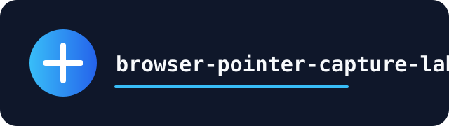

<p align="center"></p>
<p align="center"></p>
<p align="center">   </p>
<p align="center"></p>

## 🧭 Overview

`browser-pointer-capture-lab` demonstrates how an element can keep receiving pointer events after a drag moves outside its bounds. Toggle pointer capture, drag in the test area, and inspect the event lifecycle.

## ✨ Features

- 🖱️ Compare captured and uncaptured pointer drags
- 📍 Display pointer ID, pointer type, and local coordinates
- 🔔 Log pointerdown, pointermove, pointerup, pointercancel, and lostpointercapture
- 🧪 Clear and replay the event log
- 🔒 All interaction stays in the local browser

## 🧪 Demo

Run `npm start`, open `http://127.0.0.1:4174`, and drag across the test pad. Try leaving the pad while capture is enabled and disabled. No hosted demo is published.

## 🚀 Quick Start

```bash
npm start
```
Open `http://127.0.0.1:4174`. Requires Node.js 18+ and a modern browser. No npm dependencies are needed.

## 🧰 Tech Stack

- **Stack:** Node.js built-in HTTP server, Pointer Events API, HTML, CSS, and browser JavaScript
- **Approach:** small, local-first tooling with clear output

## 🗂️ Folder Structure

```text
browser-pointer-capture-lab/
├── assets/mark.svg
├── public/index.html
├── public/styles.css
├── public/app.js
├── server.js
├── package.json
├── .gitignore
├── LICENSE
└── README.md
```

## 🛣️ Roadmap

- Add multi-pointer tracking for touch devices
- Add a visual pointer-capture state timeline

## 🤝 Contributing

Issues and focused pull requests are welcome. Explain the use case, keep changes small, and add tests for behavior changes. Run the project using the Quick Start instructions before submitting.

## 📄 License

Released under the [MIT License](LICENSE).

<p align="center"></p>
